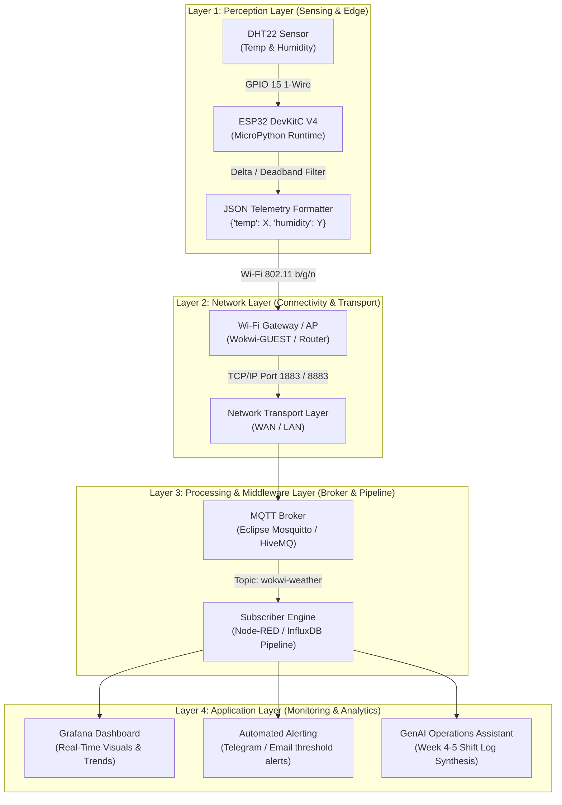

# IoT Architecture Diagram & Use Case Analysis

> **CognusOps AI Track 6-Week Internship — Week 1 Deliverable**  
> **Topic**: 4-Layer IoT Architecture for Smart Cold-Chain & Environmental Monitoring

---

## 1. System Overview & Real-World Use Case

### Use Case: Intelligent Cold-Chain Warehouse Monitoring
In industrial pharmaceutical and cold-chain logistics, temperature and humidity must remain within strict compliance thresholds (e.g. 2°C to 8°C). Any undetected excursion spoils high-value inventory. 

This project implements an edge-sensing node using an ESP32 connected to digital temperature and humidity sensors (DHT22), communicating telemetry in real-time over MQTT to centralized monitoring and alert pipelines.

---

## 2. The 4-Layer IoT Architecture



---

## 3. Layer-by-Layer Breakdown

### Layer 1: Perception (Physical / Edge Layer)
- **Hardware**: ESP32 microcontroller (Xtensa dual-core, 240 MHz) paired with a DHT22 digital relative humidity and temperature sensor.
- **MicroPython Firmware**:
  - Direct hardware register reading over GPIO 15.
  - **Deadband / Delta-Detection**: Measures conditions every 5 seconds. Compares the reading with `prev_weather`; if identical, transmission is suppressed. This saves up to 80% of edge network traffic and power consumption.

### Layer 2: Network (Connectivity Layer)
- **Protocol**: IEEE 802.11 b/g/n Wi-Fi with DHCP IP assignment.
- **Transport**: TCP/IP socket connection targeting the broker on Port 1883 (unencrypted dev) or 8883 (TLS production).
- **Transport Security**: In production environments, Wi-Fi WPA3 Enterprise and TLS v1.3 encryption protect against unauthorized packet sniffing.

### Layer 3: Middleware & Processing Layer
- **Broker**: Eclipse Mosquitto v2.1.4 / HiveMQ.
- **Pattern**: Asynchronous Publish / Subscribe architecture.
- **Topic Hierarchy**: `plant/room-1/env` or `wokwi-weather`.
- **Payload Format**: Lightweight RFC 8259 JSON:
  ```json
  {
    "device_id": "esp32-node-01",
    "temp": 24.5,
    "humidity": 42.0,
    "ts": 1795163927
  }
  ```

### Layer 4: Application Layer
- **Live Consumer**: CLI subscriber (`mosquitto_sub`) for immediate operations observability.
- **Downstream Extensions (Weeks 2–6)**:
  - InfluxDB time-series storage.
  - Grafana telemetry dashboards with out-of-band threshold alarms (> 30°C).
  - LLM Operations Assistant (Weeks 4-5) reading 24-hour log batches to generate shift summaries.

---

## 4. Key Engineering Trade-offs

| Factor | Design Choice | Alternative Considered | Justification |
| :--- | :--- | :--- | :--- |
| **Protocol** | MQTT (Pub/Sub) | HTTP / REST | MQTT requires minimal packet header overhead (2 bytes vs. HTTP >500 bytes) and supports real-time event distribution. |
| **Payload** | JSON | Protobuf / CBOR | JSON is directly human-readable and standard across modern dashboards and LLM ingestion tools. |
| **Transmission**| Delta / Change Only | Continuous 5s stream | Prevents network saturation while guaranteeing immediate reporting upon state transitions. |
