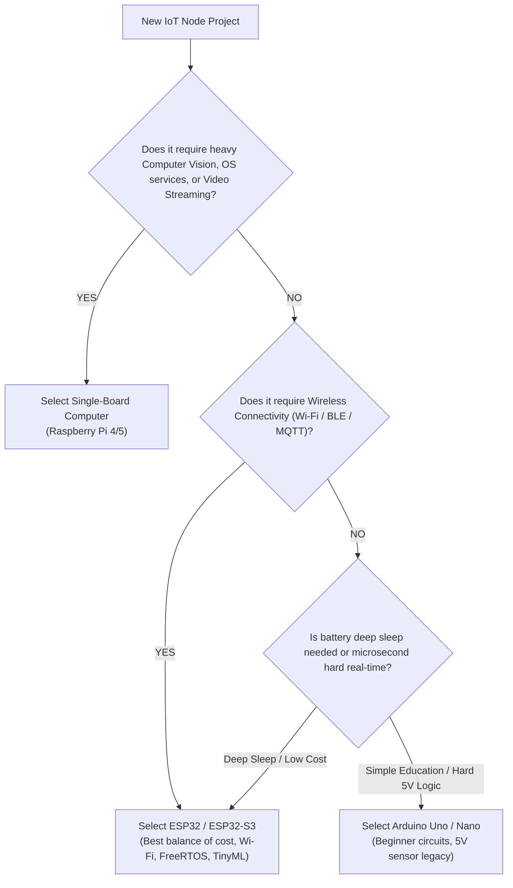

# Hardware Comparison & Sensor Typology Notes

> **CognusOps AI Track 6-Week Internship — Week 1 Tuesday Concept Notes**  
> **Author**: Lokeshkannan U (`Lokeshkannan-cognusops`)  
> **Topic**: Sensor Principles, Actuators, and Embedded Compute Platform Selection

---

## 1. Sensor Typology & Working Principles

Sensors translate ambient physical phenomena into measurable electrical signals (analog voltage, resistance, or digital protocol frames).

```
   ┌──────────────────────┐        ┌──────────────────────┐        ┌──────────────────────┐
   │ Physical Phenomenon  │  ───►  │ Transducer Element   │  ───►  │ Electrical Signal    │
   │ (Temp, Light, Gas)   │        │ (Thermistor, MEMS)   │        │ (Analog V, I2C, SPI) │
   └──────────────────────┘        └──────────────────────┘        └──────────────────────┘
```

### 1.1 Temperature & Humidity Sensors
* **DHT11 / DHT22 (AM2302)**:
  * *Principle*: Combines a negative temperature coefficient (NTC) thermistor with a capacitive polymer humidity sensor. An integrated 8-bit microcontroller serializes data across a custom single-wire proprietary bi-directional digital protocol.
  * *Characteristics*: DHT22 provides $-40^\circ\text{C}$ to $+80^\circ\text{C}$ range ($\pm 0.5^\circ\text{C}$ accuracy) and $0\text{--}100\%$ relative humidity ($\pm 2\text{--}5\%$ RH). Maximum sampling rate is $0.5\text{ Hz}$ (one reading every 2 seconds).
* **BME280 / BMP280**:
  * *Principle*: Piezoresistive micro-electro-mechanical systems (MEMS) pressure diaphragm combined with capacitive relative humidity sensing and a bandgap silicon temperature sensor.
  * *Characteristics*: Communicates over standard $I^2C$ (up to 3.4 MHz) or SPI (up to 10 MHz). Factory-calibrated with onboard trim coefficients; high precision ($\pm 0.5^\circ\text{C}$, $\pm 3\%\text{ RH}$, $\pm 1\text{ hPa}$) suitable for environmental stations and altimetry.

### 1.2 Motion & Kinematic Sensors
* **Passive Infrared (PIR - HC-SR501)**:
  * *Principle*: Employs a dual-element pyroelectric lithium tantalate ($LiTaO_3$) sensor that generates an electrical charge when exposed to infrared thermal radiation ($9.4\ \mu\text{m}$ blackbody radiation of human bodies). A segmented Fresnel dome lens focuses ambient infrared patterns onto the elements. Motion causes a differential voltage between elements, driving a BISS0001 signal processing IC to output a digital HIGH ($3.3\text{V}$).
  * *Characteristics*: Binary detection (motion present vs absent), adjustable trigger delay ($0.3\text{s}$ to $5\text{min}$) and sensitivity radius ($3\text{m}$ to $7\text{m}$).
* **Inertial Measurement Units (IMU - MPU-6050)**:
  * *Principle*: 3-axis MEMS accelerometer (capacitive proof mass displacement) + 3-axis MEMS gyroscope (Coriolis vibration effect).
  * *Characteristics*: Integrated Digital Motion Processor (DMP) calculates 6-DOF quaternions/Euler angles over $I^2C$, enabling vibration analytics, drone stabilization, and structural anomaly detection.

### 1.3 Light & Optical Sensors
* **Light Dependent Resistor (LDR / Photoresistor)**:
  * *Principle*: Cadmium Sulfide (CdS) semiconductor whose photon absorption excites electrons into the conduction band, decreasing electrical resistance as lux increases.
  * *Characteristics*: Analog resistance requires a voltage divider circuit into an Analog-to-Digital Converter (ADC). Highly non-linear logarithmic curve; prone to thermal drift.
* **Digital Light Sensor (BH1750)**:
  * *Principle*: Silicon photodiode with spectral response tuned to human eye sensitivity ($V(\lambda)$ curve), combined with a dedicated 16-bit integrated ADC.
  * *Characteristics*: Outputs direct Illuminance values ($1\text{--}65535\text{ lux}$) over $I^2C$ without complex calibration routines.

### 1.4 Gas & Air Quality Sensors
* **Metal Oxide Semiconductor (MOS - MQ-2 / MQ-135)**:
  * *Principle*: Tin dioxide ($SnO_2$) ceramic heated to $300^\circ\text{C}\text{--}400^\circ\text{C}$ by an internal nichrome coil. Oxygen adsorbed on the surface forms a potential barrier. Reducing gases (LPG, smoke, methane, CO) react with surface oxygen, releasing electrons and lowering the sensing layer's resistance.
  * *Characteristics*: High power draw ($150\text{--}200\text{ mA}$ at $5\text{V}$ continuous for the heater); requires 24-48h burn-in time; sensitive to humidity and cross-gas interference.
* **Nondispersive Infrared (NDIR - SCD30 / SCD40)**:
  * *Principle*: Measures optical absorption of $CO_2$ gas molecules at the specific $4.26\ \mu\text{m}$ infrared wavelength using a thermopile detector.
  * *Characteristics*: Highly selective, optical drift-compensated, true parts-per-million ($ppm$) precision for indoor air quality and HVAC monitoring.

---

## 2. Actuator Typology & Interfacing

Actuators transform low-power embedded control signals into physical motion, visual indication, acoustic alerts, or high-power electrical switching.

```
   ┌──────────────────┐  GPIO Logic (3.3V)   ┌───────────────────┐  High Power / Mains   ┌──────────────────┐
   │ Microcontroller  │  ─────────────────►  │ Driver / Isolator │  ──────────────────►  │ Load (Motor,     │
   │ (ESP32 / Arduino)│                      │ (Transistor, Opto)│                       │  Relay, Mains)   │
   └──────────────────┘                      └───────────────────┘                       └──────────────────┘
```

| Actuator Type | Operating Principle | Driving Circuitry / Safety | Typical Applications |
| :--- | :--- | :--- | :--- |
| **Electromechanical Relay** | Solenoid coil generates magnetic flux to close mechanical contact blades ($NO/NC$). | Requires flyback diode ($1N4007$) across coil to absorb inductive back-EMF spikes; optocoupler isolation prevents transients from reaching the MCU. | Switching AC mains appliances, pumps, solenoid valves, HVAC units ($10A\text{ @ }250VAC$). |
| **Solid-State Relay (SSR)** | Optically coupled TRIAC or back-to-back MOSFETs switch load electronically. | Zero-crossing switching eliminates mechanical contact arcing, sparking, and acoustic clicking; infinite cycle life. | Precision temperature control (PID heaters), industrial automation. |
| **Light Emitting Diode (LED)** | Solid-state $p\text{-}n$ junction electroluminescence. | Requires series current-limiting resistor: $R = \frac{V_{CC} - V_f}{I_f}$. Pulse Width Modulation (PWM) enables dimming. | Status indication, optical telemetry, visual alarm signaling. |
| **Piezoelectric Buzzer** | Piezo-ceramic disc deflects under applied voltage, vibrating air. | **Active buzzer**: built-in oscillator, sounds with steady DC. **Passive buzzer**: requires AC/PWM frequency square wave ($1\text{--}5\text{ kHz}$). | Audible alarms, status chirps, UI feedback. |
| **DC Motors & Steppers** | Electromagnetic Lorentz force creates continuous or stepped rotation. | H-Bridge drivers (L298N, DRV8833, A4988) supply motor current while translating low-power MCU direction/step logic pulses. | Robotics, automated door locks, valve positioning. |

---

## 3. Microcontroller vs Single-Board Computer: Hardware Comparison

Choosing the appropriate hardware platform dictates power budget, networking options, deterministic performance, and Edge AI feasibility.

| Architectural Dimension | **Arduino Uno R3 (ATmega328P)** | **ESP32 (DevKitC V4 - Xtensa LX6)** | **Raspberry Pi 4 / 5 (BCM2711 / 2712)** |
| :--- | :--- | :--- | :--- |
| **Device Classification** | 8-bit Microcontroller (MCU) | 32-bit Dual-Core MCU + ULP Coprocessor | 64-bit Quad-Core Single-Board Computer (SBC) |
| **CPU Core & Clock** | 1 Core @ $16\text{ MHz}$ | 2 Cores @ $240\text{ MHz}$ (Tensilica Xtensa LX6) | 4 Cores @ $1.8\text{--}2.4\text{ GHz}$ (ARM Cortex-A72/A76) |
| **RAM (SRAM)** | $2\text{ KB}$ | $520\text{ KB}$ internal SRAM (expandable via PSRAM) | $2\text{ GB} \text{ to } 8\text{ GB}$ LPDDR4 / LPDDR4X |
| **Flash / Storage** | $32\text{ KB}$ integrated Flash | $4\text{ MB} \text{ to } 16\text{ MB}$ SPI Flash | MicroSD card / NVMe SSD ($16\text{ GB}\text{--}1\text{ TB}$) |
| **Operating System** | Bare-metal firmware (super-loop / ISR) | FreeRTOS / MicroPython / ESP-IDF | Full Linux OS (Debian / Raspberry Pi OS / Ubuntu) |
| **Deterministic Real-Time** | **Hard Real-Time**: microsecond interrupt latency | **Firm Real-Time**: FreeRTOS pre-emptive scheduler | **Soft Real-Time**: non-deterministic OS kernel scheduling |
| **Wireless Connectivity** | None (requires external shield) | **Native Wi-Fi** ($802.11\text{ b/g/n}$) + **BLE 4.2 / 5.0** | Native Dual-band Wi-Fi ($802.11\text{ ac}$) + BLE 5.0 + Gigabit Ethernet |
| **GPIO Interface Types** | 14 Digital, 6 ADC ($10\text{-bit}$), UART, SPI, $I^2C$ | 36 Digital, 18 ADC ($12\text{-bit}$), 2 DAC, 3 UART, 2 $I^2C$, 3 SPI, PWM, Touch | 40-pin header (28 GPIO), 2 $I^2C$, 2 SPI, UART, PWM, PCIe, Camera CSI, Display DSI |
| **Power Consumption** | $\approx 20\text{--}50\text{ mA}$ ($100\text{--}250\text{ mW}$ at $5\text{V}$) | Active: $80\text{--}240\text{ mA}$ ($260\text{--}800\text{ mW}$). Deep Sleep: $10\ \mu\text{A}$ ($0.033\text{ mW}$) | Active: $600\text{--}3000\text{ mA}$ ($3\text{--}15\text{ W}$ at $5\text{V}$). Idle: $\approx 2.5\text{ W}$ |
| **Battery / Solar Viability** | Moderate (requires hardware power-down hacks) | **Outstanding** (runs months/years on Li-ion in deep sleep) | **Poor** (requires hefty battery pack / power supply) |
| **Edge AI / ML Capability** | None (insufficient memory/registers) | **TinyML / TensorFlow Lite for Microcontrollers** (keyword spotting, anomaly detection, gesture recognition) | **Full ML / Computer Vision** (OpenCV, PyTorch, YOLOv8, ONNX Runtime, LLM edge inference) |
| **Unit Cost** | $\approx \$3\text{--}\$5$ (clones) / $\$25$ (official) | $\approx \$4\text{--}\$6$ | $\approx \$45\text{--}\$90+$ |

---

## 4. Hardware Selection Decision Flowchart

When engineering IoT edge solutions, evaluate project constraints using this decision matrix:



### Key Takeaways for CognusOps Week 1 Architecture
* The **ESP32** is the premier choice for our sensor-to-MQTT pipeline because it marries **ultra-low cost (\$5)** with **integrated Wi-Fi/BLE**, **hardware PWM**, **sufficient SRAM ($520\text{ KB}$)** to run high-level **MicroPython**, and **$10\ \mu\text{A}$ deep sleep modes** for real-world environmental deployment.
* By contrast, an Arduino Uno lacks native networking, requiring expensive external Wi-Fi shields; a Raspberry Pi draws excessive power ($>3\text{ W}$), introduces boot latency (30-60s), and incurs high bill-of-materials (\$60+) that is uneconomical for simple telemetry nodes.
